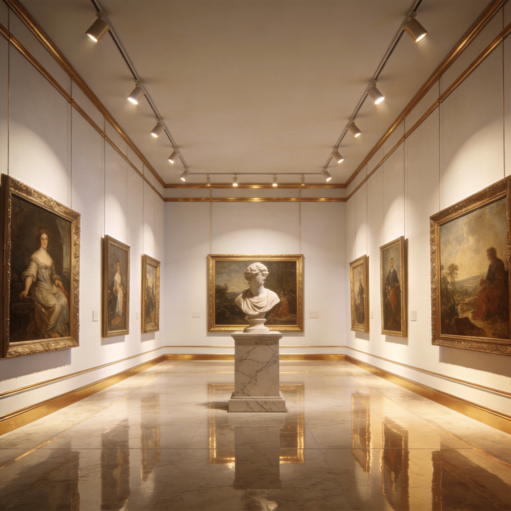
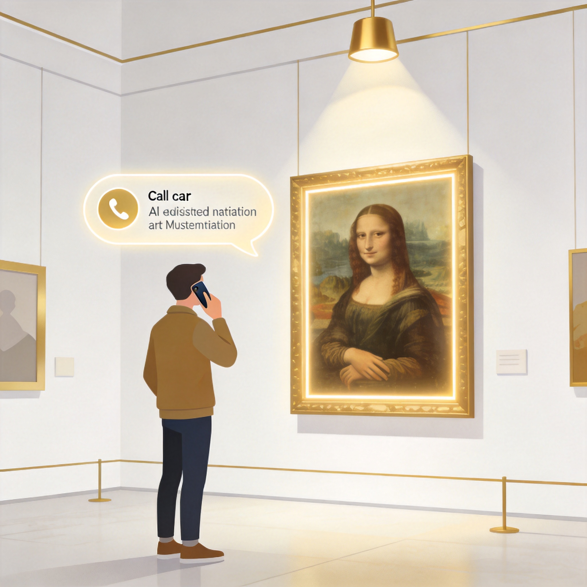
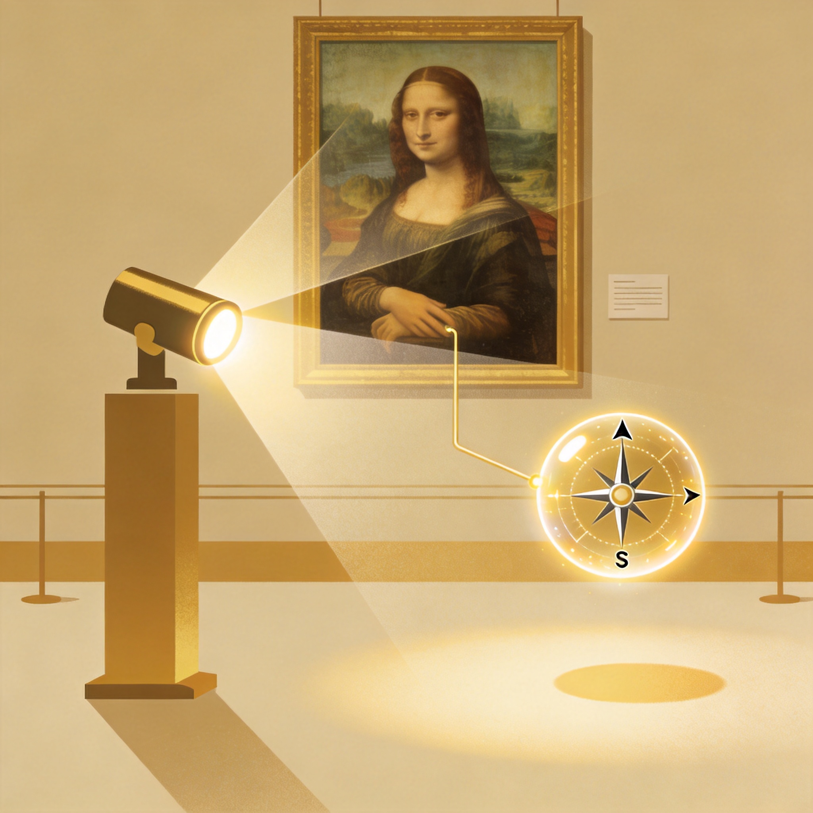
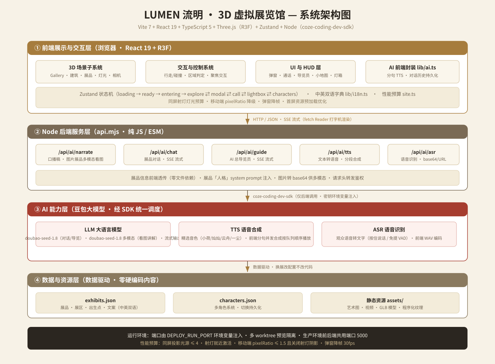

# LUMEN 流明 · 3D 虚拟展览馆

## 参赛作品项目文档

| 项目名称 | LUMEN 流明 · 3D 虚拟展览馆 —— 基于 AIGC 的沉浸式虚拟美术馆 |
| -------- | ------------------------------------------------------------ |
| 版本号码 | V1.0                                                         |
| 日　　期 | 2026.08                                                      |
| 团队名称 | [请填写团队名称]                                             |

> 参赛赛道：2026 年第五届吉林省研究生虚拟现实大赛
> 作品类别：文化创意（文化 + 科技融合）· 智能互动（VR + 教育 / VR + AI）

---

## 记录更改历史

| 序号 | 更改原因             | 版本 | 作者             | 更改日期 | 备注                     |
| ---- | -------------------- | ---- | ---------------- | -------- | ------------------------ |
| 1    | 初稿建立             | V1.0 | [请填写作者]     | 2026.08  | 覆盖项目概况、规划、方案 |
|      |                      |      |                  |          |                          |
|      |                      |      |                  |          |                          |

---

## 目录

- [1 项目概况](#1-项目概况)
  - [1.1 背景和基础](#11-背景和基础)
  - [1.2 场景和价值](#12-场景和价值)
  - [1.3 所需支持](#13-所需支持)
- [2 项目规划](#2-项目规划)
  - [2.1 整体目标](#21-整体目标)
  - [2.2 技术创新点](#22-技术创新点)
- [3 实施方案](#3-实施方案)
  - [3.1 技术可行性分析](#31-技术可行性分析)
  - [3.2 技术细节](#32-技术细节)
  - [3.3 计划和分工](#33-计划和分工)
- [4 参考资料](#4-参考资料)

---

# 1 项目概况

## 1.1 背景和基础

### 1.1.1 项目灵感

传统美术馆的观展体验受限于物理空间的边界：珍贵原作分散在世界各地，观众往往只能隔着展柜、"只能远观不可驻足"，而图文展签能承载的信息量有限、讲解也依赖真人导览，难以做到"千人千面、随问随答"。与此同时，大量已进入公共领域（Public Domain / CC0）的艺术杰作以高清数字形式向全世界开放，却缺少一个让它们"再次被看见、被走近、被凝视"的空间载体。

针对这一痛点，我们提出并实现 **LUMEN 流明 · 3D 虚拟展览馆**：一座运行在浏览器中的策展式虚拟美术馆。观众以第三人称/第一人称视角自由行走，靠近展品时射灯自动亮起、玻璃展柜自动开启，并可与每一件展品进行"打电话式"的 AI 语音对话——让画作、雕塑以自己的"第一人称"讲述身世、笔触与故事。项目将 **VR/3D 实时渲染** 与 **AIGC 多模态能力（LLM / TTS / ASR）** 融合，探索"科技 + 艺术 + 教育"的数字化表达。



<center>图 1　LUMEN 虚拟美术馆展厅主视觉（概念渲染）</center>

### 1.1.2 已有工作基础

项目已形成一套**可运行、可换展、可部署**的完整原型系统，核心工作基础包括：

- **工程基础**：Vite 7 + React 19 + TypeScript 5 + Three.js 0.185（React Three Fiber）+ Zustand + Tailwind CSS 3 的前端工程，以及基于 Node.js（纯 JS / ESM）的 AI 后端 `api.mjs`，前后端解耦、单端口部署。
- **3D 展陈能力**：完成 4 大展区（序厅·中央大厅、西翼·绘画长廊、东翼·雕塑与器物厅、影像与文献厅）及 **22 件展品**（涵盖二维绘画、三维雕塑模型、影像、文献、超链接 5 类展陈形态，对应墙挂、展台、玻璃展柜、屏幕、展板 5 种陈列方式）的搭建；含多角色换装系统（4 位观众角色）、第三方/第一人称相机、胶囊体碰撞与区域判定、聚焦光环、射灯调度等完整游历机制。
- **数据驱动机制**：展品、展区、出生点、文案全部来自 `exhibits.json` / `characters.json`，代码零硬编码内容，换展仅改配置；素材（画作高清图、GLB 模型、程序化纹理）以公共领域/CC0 方式规范化管理（如米洛的维纳斯 3D 扫描自丹麦国家美术馆 Royal Cast Collection，编号 KAS434/1）。
- **AIGC 能力**：后端已接入 `coze-coding-dev-sdk`，真实调用豆包大模型完成 **5 项 AI 服务**（展品口播 `/narrate`、展品对话 `/chat`、全馆导览 `/guide`、语音合成 `/tts`、语音识别 `/asr`），实现 LLM 流式对话（SSE 打字机）、多模态"看图讲解"、分段 TTS 准流式播报、ASR 语音输入。
- **性能与工程规范**：落实灯光预算（同屏投影光源 ≤ 4、射灯就近激活）、移动端降级（pixelRatio ≤ 1.5、关闭射灯阴影、玻璃磨砂）、弹窗降帧（30fps）、首屏资源预加载、中英双语（统一字典 + 展品双语字段）等工程化保障。

## 1.2 场景和价值

### 1.2.1 适用场景

| 场景领域 | 具体应用                                               | 对应大赛方向 |
| -------- | ------------------------------------------------------ | ------------ |
| 文旅文博 | 博物馆/美术馆线上数字展、展馆云游、馆藏科普讲解        | 文化创意     |
| 教育科普 | 艺术史/美育课堂、沉浸式导览教学、无障碍观展            | VR + 教育    |
| 内容制作 | 策展式 3D 展厅、数字动漫/影视取景、AI 创意叙事         | 内容制作     |
| 智能互动 | 与展品语音对话、AI 总导览员、自然人机交互              | VR + AI      |
| 数字孪生 | 线下场馆虚拟映射、导览路线规划、人流与动线分析          | 技术/可视化  |

### 1.2.2 潜在社会价值

- **文化普惠与无障碍**：把分散在全球的经典馆藏"搬"进浏览器，任何人无需预约、无需到场即可"走近"原作；AI 语音讲解对图文阅读障碍、视障与低龄观众更友好。
- **公共领域资源的活化**：将 Public Domain / CC0 的开放馆藏与 AIGC 结合，形成"开放内容 + 智能讲解"的可复制样板，降低公共文化机构数字化成本。
- **教育赋能**：以"与作品对话"替代单向灌输，激发学习兴趣；可作为艺术史、美育、数字媒体等课程的实践平台。
- **策展工具价值**：数据驱动的"换展改配置"机制，让策展人低门槛搭建个性化线上展厅。

### 1.2.3 对比性分析

| 对比维度       | 传统线上"全景展厅" | 常见图文 H5 展览 | 本项目 LUMEN |
| -------------- | ------------------ | ---------------- | ------------ |
| 交互自由度     | 固定机位/跳点      | 滚动/翻页        | 自由行走 + 两类相机 |
| 内容形态       | 图片 + 视频        | 图片 + 文字      | 2D + 3D 模型 + 影像 + 文献 |
| 讲解方式       | 预制音频/人工      | 图文展签         | 多模态看图讲解 + 随问随答 |
| 个性化         | 低                 | 低               | 高（每件展品独立"人格"） |
| 部署与换展成本 | 高（专项开发）     | 中               | 低（配置驱动） |

## 1.3 所需支持

项目实施与参赛打磨过程中，主要需要以下支持：

1. **算力支持**：AI 讲解/对话依赖大模型推理与语音合成，需要稳定的大模型 API 与语音服务配额（当前通过 `coze-coding-dev-sdk` 接入豆包大模型，已具备基础算力）；若本地部署离线推理，需 GPU 算力（如 NVIDIA 级显卡）支撑。
2. **硬件支持**：作品目标为浏览器端，无需观众穿戴 VR 头盔（Web 端免安装）；若参与现场互动展陈，建议提供 VR 一体机/头显（兼容 WebXR）用于更沉浸的决赛演示。
3. **内容与版权支持**：展品素材基于公共领域/CC0 授权；如需扩展当代艺术作品，需相关机构授权高清图像与 3D 数据。
4. **相关培训**：WebXR / WebGPU 性能优化、多模态大模型提示工程与 Agent 编排、语音交互（VAD/回声消除）等方面的技术培训，有助于进一步提升作品完成度。

---

# 2 项目规划

## 2.1 整体目标

**总体目标**：打造一个**"可自由行走、可与每件展品对话"的浏览器端 3D 虚拟美术馆**，并在参赛期间形成可供现场演示、评审与公测的稳定原型，验证"VR + AIGC 策展式导览"在文旅与教育场景的可行性。

**参赛期间（2026.07–2026.11）分阶段目标**：

1. **原型可用（初赛阶段）**：完成多展区、多形态展品的 3D 场景搭建，游历、聚焦、"打电话式"AI 对话、AI 总导览员等核心链路跑通，达到行业内可演示的完整度。
2. **体验打磨（初赛→决赛）**：优化灯光/氛围、相机与碰撞手感，完善多模态"看图讲解"、分段 TTS 首句秒出、中英双语切换等体验细节，通过真机与多设备（桌面/移动端）验证。
3. **初步验证（决赛阶段）**：面向评审与小范围公测用户收集反馈，量化首屏加载、渲染帧率、语音响应时延、讲解准确率等指标，形成可展示的成果演示（Demo / PPT / 演示程序）。

## 2.2 技术创新点

通过调研现有线上展览与 AIGC 导览产品，本项目的主要创新点如下：

1. **AIGC 赋能的"展品第一人称"语音讲解**：不同于传统预录式导览，每件展品被注入独立"人格" system prompt，观众以**通话（打电话）隐喻**与画作/雕塑进行流式对话，支持"按住说话"与"免提 VAD"两种输入，实现随问随答、对话历史持久化。

2. **多模态"看图讲解"**：`/api/ai/narrate` 对图片展品读取本地原图并转为 base64 data URI，调用多模态大模型（`doubao-seed-1-8-251228`）真正"看画"——理解笔触、构图与色调后再生成第一人称讲解词；无图或读取失败自动降级为纯文本 prompt，链路健壮。



<center>图 2　AI 语音讲解：观众与展品"打电话式"对话（概念示意）</center>

3. **分段 TTS 的"准流式"播报**：针对大模型 TTS 无原生流式接口的问题，前端将讲解/回复按句切分、并发合成多段音频，再按"队列顺序播放"，显著降低首句等待（从"整段合成"降到"首句秒出"），配合底部影视字幕形成听觉 + 视觉双通道体验。

4. **AI 总导览员（全馆 Agent）**：后端 `/api/ai/guide` 以展品清单为事实底座（fact grounding）做路线规划、展品推荐与答疑，SSE 流式打字机输出，避免大模型"一本正经地胡说"，实现从"单件讲解"到"全馆策展式导览"的跃升。



<center>图 3　多模态"看图讲解"与 AI 总导览员（概念示意）</center>

5. **数据驱动 + 性能预算的工程创新**：展陈内容全 JSON 化（换展改配置不改代码）；将"灯光预算、像素比降级、射灯就近激活、弹窗降帧"等性能策略前置为系统常量，保障中低端设备流畅运行，移动端与桌面端自适应。

6. **浏览器端免装 + 单人单端口部署**：全程 Web 免安装，无需观众穿戴设备；前后端共用单端口（`DEPLOY_RUN_PORT`）部署，降低落地成本。

---

# 3 实施方案

## 3.1 技术可行性分析

### 3.1.1 数据采集与内容获取

- **展品图像/模型**：采用**公共领域 / CC0 授权**的馆藏资源（如大都会艺术博物馆、丹麦国家美术馆 SMK 等开放数据），规避版权风险；3D 雕塑通过开放铸件扫描（GLB）引入，二维画作使用高清开放图像，视频与文献使用开放来源。
- **展陈知识**：展品背景、年代、材质、收藏信息由团队按规范整理为结构化 JSON（含中英双语字段），并与公共领域来源逐一核对出处（`credit` 字段记录授权与馆藏机构）。
- **行业知识（导览话术）**：通过 system prompt 注入展品"人格"与全馆展品清单，约束大模型的讲解口径与事实边界。

### 3.1.2 算力与硬件可行性

- **渲染端**：Three.js（WebGL）在主流浏览器/移动设备上即可运行，无需专用硬件；通过像素比封顶、阴影降级、雾效、降帧等策略将负载控制在低端机可承受范围。
- **AI 端**：LLM/TTS/ASR 通过云端大模型 API 调用，无需本地 GPU；后端仅做请求转发、base64 处理与 SSE 流式转发，算力需求低。
- **部署端**：纯静态产物 + 轻量 Node 服务，单端口部署，适配沙箱/云主机/边缘环境。

### 3.1.3 技术风险与应对

| 风险点                       | 应对措施                                                     |
| ---------------------------- | ------------------------------------------------------------ |
| 大模型"幻觉"导致讲解失实     | 展品清单事实底座注入 + 数据驱动"人格"约束 + 关键字段直传     |
| TTS 整段合成首响慢           | 前端分段并发合成 + 队列顺序播放，实现准流式首句秒出           |
| 移动端 WebGL 性能不足        | pixelRatio ≤ 1.5、关闭射灯阴影、玻璃磨砂、雾效、降帧         |
| 语音输入环境噪声/回声        | 前端 WAV 编码 + 压缩，ASR 服务端识别；免提 VAD 手动开关       |
| 跨域/鉴权/密钥安全           | AI 全部走后端调用，密钥环境变量注入，绝不暴露前端             |

## 3.2 技术细节

### 3.2.1 总体架构



<center>图 4　LUMEN 系统架构图</center>

系统分为四层：**① 前端展示与交互层**（React + R3F 3D 场景 + UI/HUD）、**② Node 后端服务层**（5 个 AI 接口）、**③ AI 能力层**（豆包大模型 LLM/TTS/ASR）、**④ 数据与资源层**（JSON 配置 + 静态素材）。前端与后端通过 HTTP/JSON 与 SSE 流式通信，后端通过 `coze-coding-dev-sdk` 统一调度大模型能力。

### 3.2.2 核心链路：AI 语音讲解

```
观众语音 ──(按住说话/免提VAD)──► 前端录音并编码 WAV
   │
   └──► POST /api/ai/asr （语音识别，base64/URL）
          └──► 识别文本
                └──► POST /api/ai/chat （LLM 流式对话，SSE）
                       └──► 前端 Reader 打字机式渲染
                             └──► 前端按句切分回复
                                   └──► 并发调用 /api/ai/tts 分段合成
                                         └──► 队列顺序播放 + 底部字幕
```

- **状态机**：`loading → ready → entering → explore ⇄ modal ⇄ call ⇄ lightbox ⇄ characters`，各交互在 `Zustand` 中统一管理。
- **流式输出**：对话与导览均为 SSE（`Content-Type: text/event-stream`），前端 `fetch` + `body.getReader()` 逐块读取、打字机渲染，符合"流式优先"体验。
- **通话折叠**：对话过程中通话可折叠为悬浮胶囊 + 底部影视字幕，观众边走动边对话、边看展品，避免遮挡场景。

### 3.2.3 3D 场景与渲染优化

- **场景构成**：墙/地/天花/标题墙/轨道等建筑模块，展品组件（WallFrame / Pedestal / Vitrine / Screen / Panel）按 `mount` 类型装配；程序化纹理生成纸面、黄铜等材质。
- **交互系统**：`PlayerController`（行走/转向/疾跑）、胶囊体 vs AABB/圆柱碰撞检测、区域判定（`zones`）、聚焦与交互（`interaction`）、键盘/指针/触屏多输入。
- **性能预算**（`site.ts` 常量）：同屏投影光源 ≤ 4、射灯按玩家距离就近激活；移动端 pixelRatio ≤ 1.5、关闭射灯阴影、玻璃磨砂；弹窗/灯箱打开时降帧 30fps；首屏 LCP 图片 `fetchpriority=high`、非首屏懒加载、CLS 预留 `aspect-ratio`。

### 3.2.4 预期技术指标

| 指标                     | 目标值                                       |
| ------------------------ | -------------------------------------------- |
| 首屏可交互时间（LCP）    | 桌面 < 2.5s，移动端 < 3.5s                   |
| 运行时帧率               | 桌面 ≥ 55fps，移动端 ≥ 30fps                 |
| 语音识别准确率（正常环境）| ≥ 90%（中文普通话）                           |
| 对话流式首字时延         | 桌面网络 < 1.5s                               |
| 分段 TTS 首句出音        | ≤ 1.5s（相较整段合成明显缩短）                |
| 讲解事实准确率           | 展品属性字段 100% 一致，延展内容可控无失实    |

## 3.3 计划和分工

### 3.3.1 整体计划（对齐赛程）

| 阶段       | 时间             | 主要工作                                             | 里程碑/产出               |
| ---------- | ---------------- | ---------------------------------------------------- | ------------------------- |
| 报名立项   | 2026.07（7.1–9.30）| 组队、确定选题、搭建 3D 场景骨架与 AIGC 链路          | 报名表 + 可运行 Demo       |
| 初赛打磨   | 2026.10          | 完善展陈内容、AI 讲解/导览、性能优化、双语            | 初赛作品文件（Demo/PPT）   |
| 决赛冲刺   | 2026.11          | 现场演示准备、答辩 PPT、真机适配、指标验证            | 现场演示与答辩             |

### 3.3.2 团队分工（示例，最多 4 人，研究生比例 ≥ 50%）

| 角色       | 主要职责                                         |
| ---------- | ------------------------------------------------ |
| 队长（在读研究生） | 总体架构设计、后端 AI 服务、系统集成        |
| 成员 1     | 3D 场景与渲染（Three.js / R3F）、展品建模         |
| 成员 2     | 交互系统与 UI/HUD、移动端适配与性能优化            |
| 成员 3     | 展陈内容整理、多模态提示工程、测试与文档            |

> 注：以上为建议分工，最终以团队实际成员与申报为准；指导教师最多 2 名，作品第一作者所在单位为参赛单位。

---

# 4 参考资料

1. 吉林省学位与研究生教育学会.《关于举办 2026 年第五届吉林省研究生虚拟现实大赛的通知》. 2026.07.
2. 舞台/馆藏开放数据：大都会艺术博物馆公开藏品（The Metropolitan Museum of Art Open Access，CC0 / Public Domain）。
3. 3D 模型来源：丹麦国家美术馆 SMK Royal Cast Collection（CC0 / Public Domain，如米洛的维纳斯铸件 KAS434/1）。
4. Three.js 官方文档. https://threejs.org/ ；React Three Fiber 文档. https://docs.pmnd.rs/react-three-fiber/。
5. React 官方文档. https://react.dev/ ；Vite 官方文档. https://vitejs.dev/ 。
6. coze-coding-dev-sdk（大模型 / TTS / ASR / 多模态能力接入）使用规范。